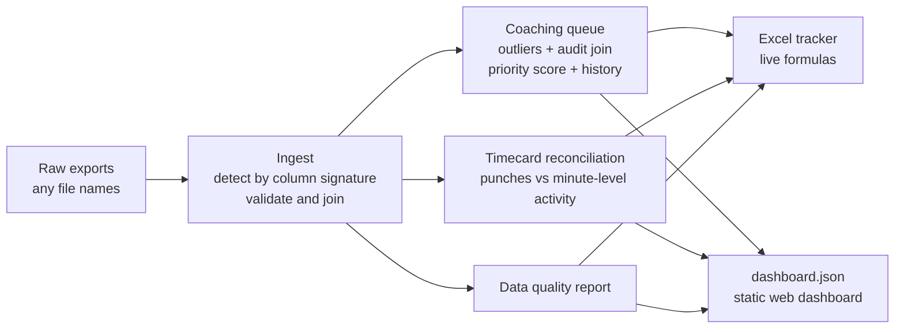

# Ops Exception Engine

**Live demo:** https://YOUR-USERNAME.github.io/ops-exception-engine/

A Python pipeline that takes messy operations exports (roster, productivity, process audits, timecards, scan activity), reconciles them against each other, and produces a ranked list of what a manager should act on, as both an Excel tracker and a web dashboard.


> **All data in this repo is synthetic.** This is a from-scratch rebuild of tools I built during an operations internship. No real names, IDs, rates, timecards, internal systems, or company data are included. The site, people and numbers are randomly generated by `opsengine/generate.py`, with known problems planted so the pipeline has something to find.

## The problem

Every week a floor manager has the same questions and five exports that each answer part of them:

- Who is meaningfully slower than the site, and has anyone actually observed them working?
- When someone was audited, which step of the process is costing them time?
- Who has been flagged before for the same reason, meaning last week's coaching didn't work?
- Do the timecards match what people were actually doing? (Unpunched meals and work after clock-out are pay and compliance risks.)

Doing this by hand means VLOOKUPs across files with inconsistent names, silent `#N/A`s, and no memory of last week. This project automates the whole loop.

## What it does



**1. Ingest** (`opsengine/ingest.py`). Files are identified by their columns, not their names, so `employee_list(3).csv` and `roster_final.xlsx` both work. Cross-file problems are reported instead of silently dropped: logins with hours but no roster record, duplicate rows, terminated associates still logging hours, malformed audit answers.

**2. Coaching queue** (`opsengine/coaching.py`). Associates slower than the 80th percentile of the site (with at least 10 hours) are flagged and joined to their most recent audit that week. Each gets one of three next steps:

| Status | Meaning | Next step |
|---|---|---|
| Failed checks | Audit found a specific process miss | Coach that check, with a concrete tip |
| Passed, still slow | Checklist can't explain the gap | Ask directly; look at item mix, layout, equipment, fatigue |
| No audit | Nobody has observed them yet | Check in, then schedule an audit |

The queue is sorted by a priority score combining distance from the site median, consecutive weeks flagged, missing audits and number of failed checks. History is replayed from week 1 on every run, so results are deterministic and the build is idempotent.

**3. Timecard reconciliation** (`opsengine/reconcile.py`). Timecard segments are compared against per-minute scan activity for each shift (including shifts that cross midnight):

| Rule | Severity | Signal |
|---|---|---|
| Unrecorded meal | High | No meal punch, but activity stops for 25+ minutes |
| Missed meal | High | Shift over 6h, no meal punch and no break in activity |
| Activity during recorded meal | High | Scans during the punched meal; also locates the break they actually took |
| Activity off the clock | High | Scans outside punched time |
| Short meal / Late meal | Medium | Under 30 minutes, or starting more than 5h into the shift |
| Unexplained idle gap | Low/Medium | 20+ minutes of paid time with no activity and no explanation |

All thresholds live in `opsengine/config.py`.

**4. Output** (`opsengine/report.py`). An Excel tracker whose summary tab is built from live `COUNTIF` formulas over the detail tabs, and a JSON payload that drives the static dashboard in `docs/`.

## Run it

```bash
git clone https://github.com/YOUR-USERNAME/ops-exception-engine.git
cd ops-exception-engine
pip install -r requirements.txt

python -m opsengine generate      # writes synthetic exports to data/raw/
python -m opsengine build         # runs the pipeline for the latest week
python -m pytest -q               # 12 tests
```

Then open `docs/index.html` in a browser, or `output/ops_tracker_week04.xlsx` in Excel.

Options: `build --week 3` runs an earlier week, `build --input path/to/folder` points at a different folder, `generate --seed 42` makes a different dataset.

Sample run:

```
Scanning data/raw for input files...
  roster        employee_list_export.csv
  productivity  productivity_by_week.csv
  audits        audit_results.xlsx
  timecards     timecard_segments.csv
  activity      scan_activity_by_minute.csv.gz

Week 4: 12 flagged, 8 audited, 30 timecard exceptions (17 high), 4 data quality issues
```

## Project layout

```
opsengine/
  config.py      thresholds, checklist, coaching tips
  generate.py    synthetic data with planted anomalies
  ingest.py      file discovery, schema detection, data quality checks
  coaching.py    outlier flagging, audit join, priority score, week-over-week history
  reconcile.py   timecard vs activity reconciliation rules
  report.py      Excel tracker and dashboard JSON
  __main__.py    CLI
tests/           unit tests for each rule plus an end-to-end test
docs/            static dashboard served by GitHub Pages
```

## Design decisions

- **Detect files by schema, not name.** Real exports never have stable file names; matching on column signatures removed the most common failure.
- **Report bad joins instead of hiding them.** A missing roster record in a spreadsheet becomes a silent `#N/A`. Here it becomes a row in the data quality report.
- **Link related exceptions.** A break taken at the wrong time shows up in the data as both "activity during meal" and "idle gap elsewhere". The engine pairs them into one exception that names the real break time, because that's the one fix a timekeeper needs to make.
- **The output has to work for people who live in Excel.** The tracker keeps live formulas so a manager can filter or edit and the summary still adds up.
- **Every threshold is a named constant.** Rules people act on should be reviewable in one file.
